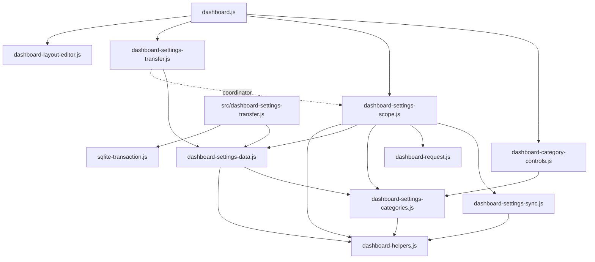

# Brooks-Lint Health Dashboard

- [Brooks-Lint Health Dashboard](#brooks-lint-health-dashboard)
  - [Dashboard](#dashboard)
  - [Module Dependency Graph](#module-dependency-graph)
  - [Top Findings](#top-findings)
    - [Warning](#warning)
  - [Test Suite Map And Verification](#test-suite-map-and-verification)
  - [Recommendation](#recommendation)

## Dashboard

**Mode:** Health Dashboard

**Scope:** All changes on `76-remove-general-scope-selector` relative to local base branch `main`: `9322f25...6dd1574`, one implementation commit, 25 changed files, 377 insertions and 61 deletions. The working tree was clean before review. All four dimensions assess this branch and its directly affected dependencies, not the entire project's historical debt.

**Composite Score:** 99/100

**Trend:** 100 → 99 (−1) from the previous Health Dashboard record. That record assessed this task's plan; this review assesses its implementation, so the scores are not directly comparable.

No `.brooks-lint.yaml` exists; balanced defaults apply. General's selector removal and independent Global transfers are implemented, but one new admission guard also blocks an unrelated Local Weather operation.

| Dimension | Score | Top Finding |
|-----------|-------|-------------|
| Code Quality | 95/100 | W1: Global imports now block Local Weather city saves |
| Architecture | 100/100 | UI filtering remains separate from eight-category ownership |
| Tech Debt | 100/100 | Transfer authority is narrow and existing storage formats remain intact |
| Test Quality | 100/100 | Clear deterministic coverage; W1's missing path is reported with the regression |

One Warning deducts 5 from Code Quality. W1 is counted once, not duplicated as a separate test finding. Composite: `95 × 0.25 + 100 × 0.30 + 100 × 0.25 + 100 × 0.20 = 98.75`, rounded half-up to 99. Scores are scoped diagnostic signals, not proof that every behavior is correct.

## Module Dependency Graph

Solid arrows show relevant imports; the dotted arrow shows the injected coordinator relationship. Browser/server HTTP transport and persistence details remain outside the pure category and preference validators.

A static scan of relative imports across 74 JavaScript files in `public/` and `src/` found no cycles. This does not cover dynamic imports or external-package internals. Existing dashboard fan-out is composition-root wiring, not a new layering violation. Keeping eight stored policy owners while rendering seven selectors avoids an unnecessary storage migration; preserving the saved General mode is the plan's explicit compatibility decision.

## Top Findings

### Warning

**W1 — Change Propagation (R2): Scope import exclusion to shared mutations, not Local Weather city saves**

**Symptom:** The added unconditional `if (importing)` at `public/dashboard-settings-scope.js:125` rejects every `beginIntegrationAction()`, before resolving its category and backing mode. The production city-selection handler at `public/dashboard.js:416-429` calls `beginAction('weather')` even when Weather is Local; its initial `weather.pending` check permits the operation because Local categories are not pending during Global imports. Thus an enabled Local city action reaches the new guard and fails with `Wait for the Global settings import before changing server resources.` The new concurrency test at `test/dashboard-settings-scope.test.js:281-303` verifies a Local General preference save during import, but not Local Weather's distinct action-admission path.

**Source:** The Pragmatic Programmer — Orthogonality; Refactoring — Divergent Change. A shared-store transaction now changes the availability of an independently owned Local operation through a common action entry point.

**Consequence:** A pending Global import prevents users from choosing a browser-local city, although the action does not write the imported Global weather row. This regresses base-branch behavior and the plan's Local-save independence requirement (`2-plan.md:49,75`). The message incorrectly describes the blocked operation as changing server resources. A slow import or its request deadline unnecessarily holds up otherwise independent Local work; existing passing preference-save tests do not expose this path.

**Remedy:** Resolve and validate the action's current category/token first, then apply import exclusion only to mutations sharing the Global resources being imported. Continue rejecting Global Weather and other shared configuration actions, while allowing validated Local Weather location actions to follow their existing Local storage path. Add a regression that holds an import response pending, admits a Local Weather action, saves a city through that action path, and verifies only the Local record changes. Include a Global Weather rejection control; do not remove shared-action exclusion altogether.

**Verification:** A read-only inline Node reproduction used the real coordinator with General Global, Weather Local, and a deferred import response. It confirmed `weather.mode === 'local'` and `weather.pending === false`, then observed the action rejection while an ordinary Local preference save still succeeded. A second reproduction loaded the unmodified `main` coordinator directly from Git and ran the same pending-import/city-save workflow: `main: Local city saved`; `branch: Wait for the Global settings import before changing server resources.` No repository test or implementation file was changed for either reproduction.

No Critical or Suggestion findings were identified. The remaining checks found no separate actionable architecture, debt, or test-structure issue within scope. File generations and transfer-map tokens protect preparation ownership; captured raw revisions remain independent of Local General revisions; successful imports still use the existing transactional server API. The narrow one-shot path for all-Local clients is justified because inactive shared synchronization does not perform reads.

## Test Suite Map And Verification

- Current portfolio: 70 top-level Node `*.test.js` files and 12 browser `*.spec.js` files. Node files mix pure unit, controller/storage integration, HTTP/database, and process/network coverage; no exact per-case unit/integration ratio is claimed. The implementation-stage record reports 697 Node-discovered cases and 201 browser cases, including fixture-file entries in Node's count.
- Changed unit/control coverage: `test/dashboard-category-controls.test.js` verifies seven selectors, General's absence, and safe updates for all eight owners. `test/dashboard-settings-transfer-controls.test.js` exercises file validation, preparation enablement, draft guards, retained files, explicit reload, superseded preparation, and disposal using deterministic fakes. DOM IDs here express intentional UI contracts rather than private helper names.
- Changed controller integration: scope tests cover all-Local/mixed preparation, read coalescing, raw revisions, Local revision independence, persisted-map races, unavailable/malformed reads, work exclusion, late completions, deadlines, disposal, and recovery-state publication. These meaningful negative paths are not replaced by line-coverage claims. W1 identifies the specific omitted Local action scenario rather than treating the whole suite as inadequate.
- Browser integration: changed transfer/scope specs retain raw Local/map comparisons, separate saved layout-ownership contexts, explicit failure/reload behavior, weather-only and preference conflicts, mobile control access, and no recurring all-Local Global preference reads. The home-page keyboard test now expects Export after entering General, not the removed selector. Removing obsolete General-switch interactions is appropriate for the requested behavior change, not test brittleness.
- Independently rerun during this review: `npm run check` passed, followed by the six focused category-control, transfer-control, category, scope, sync, and transfer test files; all 73 cases passed. `npm run test:browser -- e2e/global-settings-transfer.spec.js` then passed all three Chromium cases in approximately four seconds. The two inline regression reproductions also completed with their expected assertions.
- The complete Node/browser suites and dedicated Firefox scenarios were not rerun during this review. Their final implementation-stage results remain in `4-implemented.md`: 697 Node cases and 201 browser cases passed. That record also preserves an intermediate browser timeout/crash and successful unchanged repeated/final runs; this review does not reclassify those events as a newly proven branch defect.
- Review verification used no real upstream integrations or Wake actions. Static import-cycle and whitespace checks supplement runtime tests; final `git diff --check` is required before committing these records. No fixes were implemented, and the reviewed goal, plan, and implementation record were left unchanged.

## Recommendation

Address W1 before merging: preserve the shared-action exclusion while restoring Local Weather action independence, then add the deferred-import regression and rerun focused scope/transfer tests. A focused code-quality review of mutation admission is the highest-value follow-up; a storage redesign or removal of the retained General compatibility entry is not justified. The selector removal, raw Global transfer preparation, and existing-layout preservation otherwise follow the reviewed plan. This stage records findings only.
