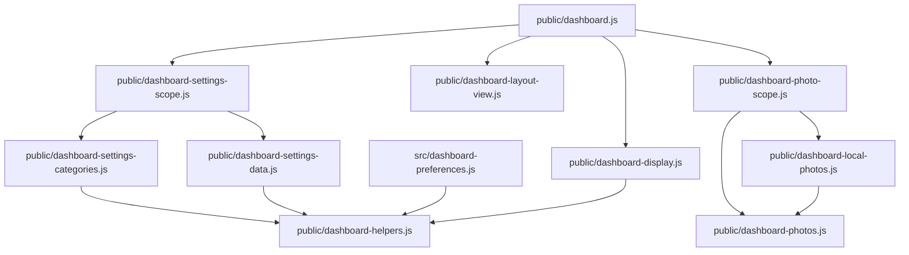

# Brooks-Lint Health Dashboard

- [Brooks-Lint Health Dashboard](#brooks-lint-health-dashboard)
  - [Dimension Scores](#dimension-scores)
  - [Module Dependency Graph](#module-dependency-graph)
  - [Top Findings](#top-findings)
  - [Test Suite Map](#test-suite-map)
  - [Recommendation](#recommendation)

**Mode:** Health Dashboard

**Scope:** Plan review of `tasks/77-image-visibility/2-plan.md` at `1d189cc`, checked against the existing settings, display, layout, and photo-controller boundaries. This is not a whole-project audit or implementation verification. No `.brooks-lint.yaml` was found; balanced defaults apply. The unrelated working-tree change to `todo.md` was excluded and left untouched.

**Composite Score:** 100/100

**Trend:** Previous Health Dashboard score 99 → 100 (+1). The previous record covered a different branch review, so this is not evidence of project-wide improvement.

The plan is ready to implement. No actionable findings were identified within this scope.

## Dimension Scores

- Code Quality: Not scored; no implementation diff exists for this task. The planned edits reuse category form handling and keep asynchronous photo callbacks on the shared display path.
- Architecture: 100/100. Visibility belongs to the pure display projection; NFS configuration and slideshow ownership remain unchanged.
- Tech Debt: 100/100. The plan avoids new storage keys, schema versions, playback flags, and controller lifecycle branches. Additive compatibility decoding preserves strict current-write validation.
- Test Quality: 100/100. Planned coverage addresses missing fields, explicit `false`, invalid input, category isolation, delayed rendering, captions, persistence, and real decoded images.

With Code Quality omitted, the composite uses redistributed weights: Architecture `0.30 / 0.75`, Tech Debt `0.25 / 0.75`, and Test Quality `0.20 / 0.75`. All assessed dimensions score 100. These scores describe the plan, not unimplemented code or test results.

## Module Dependency Graph

Arrows show imports or composition dependencies in the affected design, not a complete project dependency graph.

The plan does not introduce a dependency from display projection into controllers, requests, or persistence. `public/dashboard-layout-view.js:71-95` reparents the caption but does not currently overwrite its `hidden` property, so the projection can remain the visibility owner without a layout subsystem redesign.

## Top Findings

None. No Critical, Warning, or Suggestion findings met the evidence threshold.

The R1–R6 scan found no proposed cognitive, propagation, duplication, complexity, dependency, or domain-model issue requiring a plan change. In particular, coordinated edits to schema, category metadata, and presentation belong to the same feature boundary and are not unrelated shotgun surgery.

The T1–T6 scan found no concrete defect in the proposed test strategy. Preference validation belongs in small boundary tests; browser tests verify distinct rendering, synchronization, and lifecycle risks. Continuing playback while hidden is an explicit, reasonable tradeoff for a presentation-only option, not an omitted resource-management feature.

## Test Suite Map

- Existing Node.js suite: 70 `test/**/*.test.js` files. A static import-based classification identifies 51 unit/component-oriented files and 19 integration-oriented files importing SQLite, the application server, or the database store. This is a file-level estimate, not a test-case count or timing measurement.
- Existing browser suite: 12 `e2e/**/*.spec.js` files. Real PNG fixtures and isolated settings environments already support the proposed rendering checks.
- Relevant seams inspected: `test/dashboard-display.test.js`, `test/dashboard-widget-scales.test.js`, `test/dashboard-settings-transfer.test.js`, and `e2e/settings-environment.js`, alongside their production boundaries.
- Tests were not run because this task reviews a plan and changes no implementation. The implementation must run the checks listed in `2-plan.md:58` before claiming acceptance.

## Recommendation

Proceed with implementation as written. Keep strict validation separate from persisted-data/import upgrades, and let the shared display projection own photo and caption visibility. Verify delayed photo completion cannot reveal either element while hidden. No plan revision or broader audit is required before implementation.
