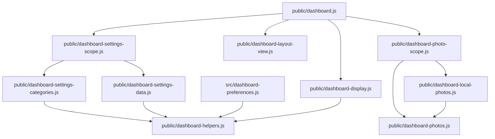

# Brooks-Lint Health Dashboard

- [Brooks-Lint Health Dashboard](#brooks-lint-health-dashboard)
  - [Dimension Scores](#dimension-scores)
  - [Module Dependency Graph](#module-dependency-graph)
  - [Top Findings](#top-findings)
    - [Warning](#warning)
  - [Test Suite Map](#test-suite-map)
  - [Verification](#verification)
  - [Recommendation](#recommendation)

**Mode:** Health Dashboard

**Scope:** All 26 committed changed paths on `77-image-visibility` relative to `main`, merge base `c444455` through implementation commit `d8d315b`. Reviewed production code, added tests, release metadata, documentation, and implementation results. The unrelated uncommitted `todo.md` change is excluded and untouched. No `.brooks-lint.yaml` exists; balanced defaults apply.

**Composite Score:** 99/100

**Trend:** 100 → 99 (−1) from the latest Health Dashboard record. The previous record reviewed the plan rather than implemented code; these scores are not a project-wide quality trend.

Production changes look sound within the reviewed scope. One browser-test reliability warning remains, and integration/browser acceptance is still blocked by the installed Node.js runtime.

## Dimension Scores

- Code Quality: 100/100. The preference uses existing category form handling, and its saved change triggers the common display projection without reconfiguring photo playback.
- Architecture: 100/100. Visibility stays in presentation; strict validation and additive compatibility decoding retain separate responsibilities. No new dependency edge or controller lifecycle branch is introduced.
- Tech Debt: 100/100. No actionable R1–R6 findings were identified in the branch. The helper rename accurately reflects shared additive defaults, and all callers were updated. Multiple same-feature schema/UI/test edits are not unrelated shotgun surgery.
- Test Quality: 95/100. One T2 Warning for a native-animation timing race; no additional T1–T6 findings warrant deduction.

Balanced deductions are 15 per Critical, 5 per Warning, and 1 per Suggestion. Composite: `100 × 0.25 + 100 × 0.30 + 100 × 0.25 + 95 × 0.20 = 99`. The environment blocker is reported separately, not counted as an introduced code defect. Scores do not establish release readiness.

## Module Dependency Graph

Arrows represent imports/composition in the affected subsystem; unchanged supporting modules are included for context.

`public/dashboard-display.js:11-14,25` owns image/caption visibility. `public/dashboard.js:286` reapplies it on an image-only preference change, while asynchronous photo callbacks still use `applyVisibilityLayout`. The existing `[hidden]` rule in `public/dashboard.css:8` hides all photo descendants. Layout reparenting does not overwrite caption visibility. Missing stored fields gain defaults before strict validation, but current API writes remain complete and canonical.

## Top Findings

### Warning

**T2 — Test Brittleness: native transition timing is not controlled by the fake clock**

Symptom: `e2e/image-visibility.spec.js:154-165` starts a three-second transition, checks that an animation is running, and then opens Settings, selects Images, changes the checkbox, saves, and closes the dialog before checking hidden layers. `page.clock.pauseAt` and `runFor` control JavaScript clocks/timers, not the browser's native Web Animations timeline used by `public/dashboard.js:234-239`. Inspection of the installed Playwright clock implementation confirms it does not replace `Element.animate` or the document animation timeline. The running check and hide save are not atomic with respect to animation completion.

Source: *xUnit Test Patterns* — Erratic Test; *The Art of Unit Testing* — Test isolation.

Consequence: A slow browser or CI worker can finish the transition before the hide save. The test may pass without exercising hiding during a transition, or fail its running-animation check when scheduling is delayed. Advancing fake time by four seconds does not deterministically settle native animations. This weakens the specific transition regression claim even when production behavior is correct.

Remedy: In test code, capture and pause the native Animation objects in the same browser evaluation that detects the transition. Hide while the retained transition layers exist, assert all layers are hidden, then explicitly finish/resume those animations and await their completion before checking cleanup. Do not add a production-only test hook or rely on a longer timeout. Re-run this scenario repeatedly on a working Node.js/browser environment.

This is a static, source-supported finding. Browser reproduction was unavailable because Playwright fails before test startup; it is not a claim of an observed flaky run. No production defect or Critical finding was identified.

## Test Suite Map

- Project inventory: 71 Node.js test files and 13 browser spec files. Static SQLite/application/database import classification gives approximately 52 unit/component-oriented and 19 integration-oriented Node.js files; these are file counts, not test-case counts or runtime measurements.
- Branch coverage: eight changed Node.js test files, including a new migration/cache suite, plus one new browser spec containing nine expanded scenarios. Tests distinguish schema/default validation, API persistence, category ownership, DOM projection, layout reparenting, and real-image browser behavior.
- Existing test seams and real PNG fixtures are reused. No production test-only methods or dependency replacements were introduced. The branch includes invalid-value, missing-field, explicit-false, revision-conflict, and delayed-completion cases rather than only happy paths.

## Verification

- Fresh review run: `npm run check`, `node --check e2e/image-visibility.spec.js`, `bash scripts/release.sh --validate`, and `git diff --check main...HEAD` all passed.
- Fresh review run: `node --test test/dashboard-image-visibility.test.js test/dashboard-display.test.js test/dashboard-layout-view.test.js test/dashboard-settings-categories.test.js test/dashboard-widget-scales.test.js` passed all 29 tests with zero skips or failures.
- Fresh independent environment check: `node -e 'console.log(Response.json({ok:true}).status)'` fails with `SyntaxError: Unexpected token 'var'` in `node:internal/deps/undici/undici:17394` on Node.js `v24.22.1`, without importing project code.
- Fresh targeted browser attempt: `npm run test:browser -- e2e/image-visibility.spec.js` fails during Playwright initialization with the same built-in Undici syntax error. No browser scenarios ran.
- Implementation-stage full-suite evidence in `4-implemented.md`: `npm test` reported 323 passes and 160 failures, and the full browser command failed before startup. These are prior results, not new successful verification. Re-running the entire known-broken suite during review would not establish acceptance.
- No implementation fixes, dependency changes, runtime repairs, or release publication were performed during this review.

## Recommendation

Address the transition-test warning in a later implementation step, restore a working Node.js 24-or-newer environment, and rerun the full Node.js suite and all browser tests before merging or releasing. The focused tests and static review support the production design, but they do not replace the missing integration/browser evidence. A focused `brooks-test` follow-up can reassess test reliability after those runs; a broader architecture refactor is not indicated.
