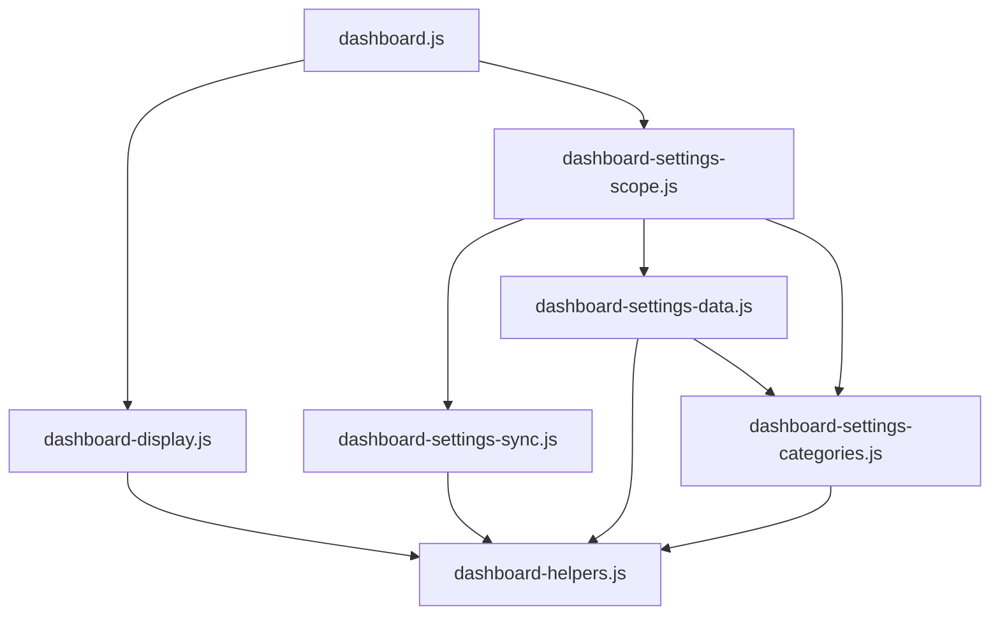

# Brooks-Lint Health Dashboard

- [Brooks-Lint Health Dashboard](#brooks-lint-health-dashboard)
  - [Assessment](#assessment)
  - [Module Dependency Graph](#module-dependency-graph)
  - [Test Suite Map](#test-suite-map)
  - [Top Findings](#top-findings)
  - [Recommendation](#recommendation)

## Assessment

**Mode:** Health Dashboard

**Scope:** Plan review of `tasks/79-image-display-option/2-plan.md` at `1f23863`, checked against the goal and affected settings, display, lifecycle, and test modules. This is not a whole-project code audit or implementation approval.

**Composite Score:** 100/100

**Trend:** 99 → 100 (+1) from the previous Health Dashboard entry; scopes differ, so this is not a measured codebase improvement.

- Code Quality: 100/100. The plan names concrete edits, preserves existing controls, and states observable acceptance criteria.
- Architecture: 100/100. Preference migration and pure display projection remain separate from playback and DOM orchestration.
- Tech Debt: 100/100. Existing category ownership and additive compatibility paths are reused; no new settings framework is proposed.
- Test Quality: 100/100. Planned tests distinguish profile selection, fullscreen precedence, migrations, scope isolation, and lifecycle regressions.

Balanced scoring uses weights 0.25, 0.30, 0.25, and 0.20 respectively. No findings warrant deductions. No `.brooks-lint.yaml` exists.

## Module Dependency Graph

Arrows show selected existing imports relevant to the plan, not the complete project graph.

No new dependency direction or cycle is required. Existing fullscreen and mobile callbacks already reach `applyVisibilityLayout()`, supporting the proposed reuse.

## Test Suite Map

- Repository inventory: 71 Node test files and 13 browser spec files. Node files include both unit and integration tests; these are file counts, not executed case counts.
- Focused Node coverage: nine relevant files contain 132 static `test()` declarations across projection, migration, DOM/layout, categories, API persistence, scopes, synchronization, and transfers.
- `e2e/image-visibility.spec.js` contains six static declarations, some expanded by loops. It already uses controlled clocks, real settings persistence, and retained-photo checks.
- The plan correctly calls for updating tests that currently assume `imageVisible` controls mobile. Boundary checks at 600/601px and fullscreen exit distinguish the new behavior from the old behavior.
- Tests were inspected, not run. No implementation exists for the proposed fields yet; runtime correctness and future test quality remain unverified.

## Top Findings

No actionable findings in the reviewed plan.

The main compatibility hazard is already addressed: absent mobile visibility must inherit the old image visibility value, while explicit new booleans remain independent. The plan also preserves strict validation and requires malformed-value tests rather than silently repairing invalid records.

The proposed change spans related settings and display modules within one feature; this is not unrelated change propagation. Reusing the existing projection and category mechanisms avoids duplicating policy or coupling presentation to slideshow state.

## Recommendation

Approve the plan as written. During implementation, keep the dynamic missing-field upgrade shared by both stored-preference decoders and test old hidden records explicitly. Keep the existing **Show image** label and add only the mobile and fullscreen controls. The interpretation of “like others” is stated clearly; image selection, scaling, and playback changes remain out of scope. No implementation or plan edits were made during this review.
