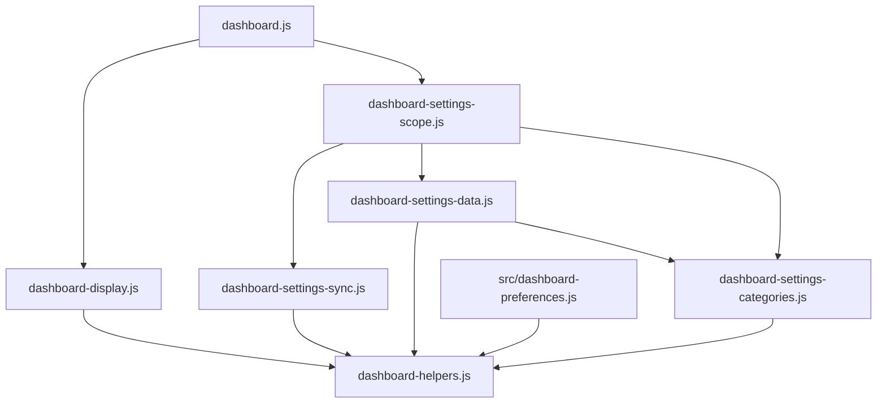

# Brooks-Lint Health Dashboard

- [Brooks-Lint Health Dashboard](#brooks-lint-health-dashboard)
  - [Assessment](#assessment)
  - [Module Dependency Graph](#module-dependency-graph)
  - [Test Suite Map](#test-suite-map)
  - [Top Findings](#top-findings)
    - [Suggestion](#suggestion)
  - [Verification](#verification)
  - [Recommendation](#recommendation)

## Assessment

**Mode:** Health Dashboard

**Scope:** All 26 committed changed paths on `79-image-display-option` relative to base `main`, `0871532...b6ddd3c`. Includes production code, tests, documentation, version metadata, and the implementation record. Excludes uncommitted changes in `docker-compose.dev.yml`, `todo.md`, and the deleted task 78 goal.

**Composite Score:** 100/100

**Trend:** Stable at 100 compared with the previous plan review; different scopes prevent a direct code-quality trend comparison.

- Code Quality: 100/100. Changes stay within image settings and display projection; no production correctness defect found.
- Architecture: 100/100. Shared preference boundaries and pure projection remain separate from playback ownership.
- Tech Debt: 100/100. Additive migration is shared across existing read paths without introducing a second preference model or new dependencies.
- Test Quality: 99/100. One limited rotation-coverage suggestion below.

Balanced scoring deducts one point from Test Quality for one Suggestion. Weighted composite: `100 × 0.25 + 100 × 0.30 + 100 × 0.25 + 99 × 0.20 = 99.8`, rounded to 100. No `.brooks-lint.yaml` exists.

## Module Dependency Graph

Selected imports relevant to the changed behavior; this is not a complete repository graph.

No imports changed. Existing server/browser validation reuse remains intact. Visibility changes reach `applyVisibilityLayout()` without entering the browser playback configuration change list. Mobile and fullscreen callbacks reuse that same projection; captions and blur cannot bypass it in the inspected code.

## Test Suite Map

- Repository inventory: 71 Node test files and 13 browser spec files; file counts include mixed test types and are not case counts.
- Focused verification: six unit-focused files cover projection, migration/cache decoding, fake-DOM layout, category ownership, scope orchestration, and synchronization. Two integration-focused files cover real HTTP/SQLite preference persistence and settings transfers. `test/dashboard.test.js` combines pure behavior and static-server checks.
- Those nine Node files execute 153 passing tests. Browser verification covers 93 passing cases across four specs, including 13 image-visibility cases.
- Migration tests distinguish missing fields from malformed present values and preserve explicit independent profiles. API and scope tests check persistence and write isolation rather than only mocked call wiring.
- Existing delayed-load, transition, and custom-layout checks remain useful. The new one-photo scenario does not exercise actual rotation for the new mobile/fullscreen conditions.

## Top Findings

### Suggestion

**[T5] Coverage Illusion — The new rotation scenario cannot rotate**

Severity: Suggestion. Dimension: Test Quality.

Symptom: `e2e/image-visibility.spec.js:77-109` claims rotation coverage but creates `settingsEnvironment({ photoCount: 1 })`, then advances clocks without asserting a new image identity. Both `src/photo-slideshow.js:19-23` and `public/dashboard-local-photos.js:28-32` deliberately skip rotation when fewer than two photos exist. The fullscreen override is also exited before the clock advance.

Source: *How Google Tests Software* — change coverage versus execution coverage; *The Art of Unit Testing* — test completeness.

Consequence: The new cases verify resize, save, reload, and fullscreen projection, but cannot detect a later regression that reveals a newly completed photo while mobile visibility or fullscreen hiding applies. Existing multi-photo tests exercise the original general image toggle, so this is a bounded regression-protection improvement, not evidence of a current production defect.

Remedy: Use at least two deterministically ordered photos in a focused rotation case, capture the current URL/name, advance the appropriate clocks until a different selection reaches the browser, and assert photos, blur, and captions stay hidden. Cover mobile-hidden/desktop-visible and fullscreen-hidden/active-profile-visible states without leaving the state before rotation.

## Verification

- Re-ran `npm run check`: passed.
- Re-ran the nine focused Node files: 153 passed, zero failed. Log: `/tmp/opencode/79-review-focused.log`.
- Re-ran `bash scripts/release.sh --validate` and `git diff --check main...HEAD`: passed.
- Inspected the completed Chromium run at the reviewed code revision: 93 passed. Log: `/tmp/opencode/79-browser-complete.log`. Browser checks were not rerun during this review.
- Full-suite evidence from implementation remains 687 passed and 25 weather-proxy failures; the same 25 failures reproduced on the pre-implementation baseline. This review did not rerun the full suite or diagnose those unrelated failures.
- The existing `undici@8.11.2` audit warning remains documented in `4-implemented.md`; this branch changes no dependency versions. No fixes, release publication, or unrelated worktree edits were made.

## Recommendation

No blocking findings. The implementation matches the planned desktop/mobile/fullscreen behavior and preserves old hidden-image choices, strict writes, Local/Global ownership, and playback separation. Strengthen the rotation test when addressing review feedback; do not treat advancing a one-photo fixture's clock as proof of rotation coverage. Existing weather-proxy failures and the dependency advisory remain separate follow-up work.
