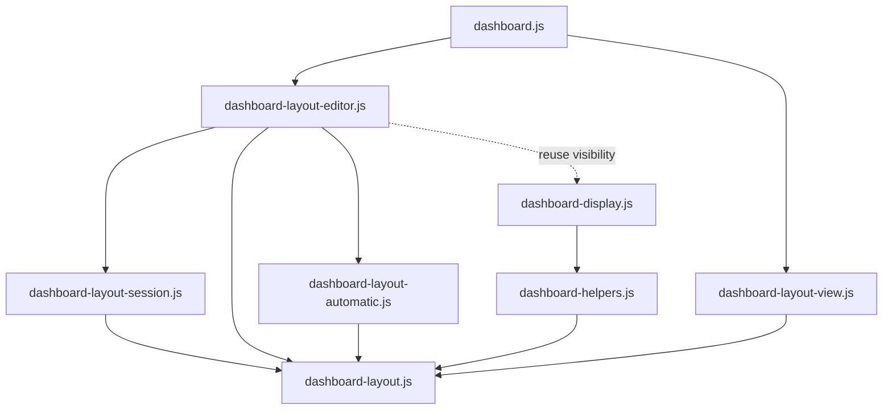

# Brooks-Lint Health Dashboard

- [Brooks-Lint Health Dashboard](#brooks-lint-health-dashboard)
  - [Assessment](#assessment)
  - [Module Dependency Graph](#module-dependency-graph)
  - [Test Suite Map](#test-suite-map)
  - [Top Findings](#top-findings)
  - [Recommendation](#recommendation)

## Assessment

**Mode:** Health Dashboard

**Scope:** Plan review of `tasks/80-hide-disabled-layout-widgets/2-plan.md` at `30ebe12`, checked against its goal and the current editor, session, layout schema, display projection, settings composition, and relevant tests. This assesses the proposed change, not the entire codebase or a completed implementation.

**Composite Score:** 100/100

**Trend:** Stable at 100 compared with the previous Health Dashboard entry; scopes differ, so this does not establish a codebase improvement.

- Code Quality: 100/100. Concrete edit points, action guards, and empty-state behavior are specified; changes stay within the requested feature.
- Architecture: 100/100. The plan reuses effective settings and shared visibility projection, keeping filtering separate from persisted layout data.
- Tech Debt: 100/100. One eligibility policy drives the UI, while the existing six-widget schema and unrestricted layer operation remain compatible.
- Test Quality: 100/100. Planned coverage distinguishes profiles, fullscreen, stale events, gestures, focus, no-op saves, hidden slots, and storage ownership.

Balanced weights are 0.25, 0.30, 0.25, and 0.20 respectively. No actionable findings warrant deductions. No `.brooks-lint.yaml` exists.

## Module Dependency Graph

Selected current dependencies and the planned display-policy reuse; this is not a complete project graph. The dashed arrow is proposed, not implemented.

No dependency cycle is required. Keep the eligibility adapter above the layout primitives; pass eligible IDs into layer operations rather than making `dashboard-layout.js` import display helpers or settings orchestration.

## Test Suite Map

- Repository inventory: 71 Node test files and 13 browser spec files. These include unit, integration, and mixed files; counts are not executed cases.
- Four directly relevant unit-focused files contain 33 static `test()` declarations: editor 6, session 7, layout primitives 13, and display projection 7.
- `e2e/dashboard-layout.spec.js` contains 47 static declarations, including current hidden-widget, inactive-profile, focus, layer, and all-hidden scenarios. Loops can expand runtime counts.
- Existing tests deliberately require the behavior being changed: all-hidden layer rows at lines 87-93, hidden-widget layer access at lines 350-363, and hidden placeholders at lines 477-487. The plan explicitly replaces those expectations while preserving covered/tiny enabled-widget and zero-canvas coverage.
- Unit tests can exercise real editor handlers through the existing DOM seam; browser tests remain necessary for native select options, focus, pointer capture, and accessibility visibility. The plan includes both levels rather than treating fake-DOM assertions as browser proof.
- No tests were run in this plan review. The new behavior has not been implemented or verified.

## Top Findings

No actionable findings in the reviewed plan.

- The inactive-profile risk is addressed correctly. `getCategoryState('general')` exposes composed effective preferences through `public/dashboard-settings-scope.js:32-37`; the editor can combine those preferences with `session.mode` instead of using current-viewport DOM flags.
- Empty selection is a real implementation concern: current projection and announcement paths assume a selected item. The plan names those paths, disables widget-only actions, and retains an escape/recovery route when every widget is hidden.
- The plan covers stale numeric events and captured gestures before selection changes. Preserving completed drafts and original save tokens avoids silently rebasing layout edits after remote visibility updates.
- Visible-only layer ordering is a justified behavior decision, not a new generic ordering framework. Its fixed-hidden-slot rule protects stored layers and geometry while making visible Up/Down controls predictable. Existing unrestricted callers remain supported.
- Schema preservation is explicit: `normalizeWidgetLayout()` requires all six entries. Filtering only editor surfaces avoids deletion, migration, and unintended writes when visibility changes.

## Recommendation

Approve the plan as written. Implement shared eligibility and safe selection reconciliation before changing individual controls, then verify empty-state and mid-gesture visibility changes first. Keep layout primitives independent of display/settings modules, and preserve all six saved entries. The test plan and acceptance criteria cover the identified risks without requiring broader editor restructuring. No implementation code or plan edits were made during this review; unrelated local changes remain untouched.
