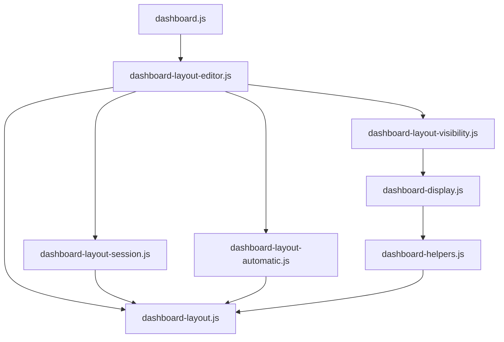

# Brooks-Lint Health Dashboard

- [Brooks-Lint Health Dashboard](#brooks-lint-health-dashboard)
  - [Assessment](#assessment)
  - [Module Dependency Graph](#module-dependency-graph)
  - [Test Suite Map](#test-suite-map)
  - [Top Findings](#top-findings)
  - [Verification](#verification)
  - [Recommendation](#recommendation)

## Assessment

**Mode:** Health Dashboard

**Scope:** All 21 committed changed paths on `80-hide-disabled-layout-widgets` relative to base `main`, `2b6224e...6d24882`. Includes production code, tests, documentation, release metadata, and the implementation record. Excludes unrelated uncommitted changes in `docker-compose.dev.yml`, `todo.md`, and the deleted task 78 goal.

**Composite Score:** 100/100

**Trend:** Stable at 100 compared with the previous plan review. Different review scopes prevent a direct codebase-quality trend comparison.

- Code Quality: 100/100. No actionable correctness or change-propagation issue found in the reviewed changes.
- Architecture: 100/100. Shared display policy feeds editor eligibility; layout primitives accept IDs without depending on settings or DOM details.
- Tech Debt: 100/100. Filtering does not create a second layout schema, migrate records, or introduce unrelated dependencies.
- Test Quality: 100/100. Tests exercise observable editor behavior, unchanged storage, stale-event guards, gesture rollback, and profile ownership.

Balanced weights are 0.25, 0.30, 0.25, and 0.20 respectively. No actionable findings warrant deductions. No `.brooks-lint.yaml` exists.

## Module Dependency Graph

Selected imports relevant to the changed behavior; this is not a complete repository graph.

The new dependency path remains acyclic in this slice. `changeWidgetLayer()` receives an eligible-ID list rather than importing display policy. Existing server validation and six-widget persistence remain unchanged.

## Test Suite Map

- Repository inventory: 72 Node test files and 13 browser spec files. File counts include unit, integration, and mixed suites; they are not executed case counts.
- Nine unit-focused layout/display files execute 98 passing tests, covering pure projection and geometry, session ownership, real editor handlers through a DOM seam, view behavior, activation, and reference measurement.
- Four browser specs produced 89 passing Chromium cases. They cover layout editing, background visibility, category scope, and image visibility with real settings persistence. One existing Firefox/Chromium interoperability case remains separately blocked by missing Firefox.
- The changed editor tests distinguish disabled visibility from covered, tiny, or unavailable-canvas widgets. They verify inactive-profile eligibility, empty selection, no-op writes, preserved completed drafts/tokens, stale queued input, and captured-pointer rollback.
- Browser tests verify native selector filtering, focus recovery, fullscreen/breakpoint behavior, remote updates, Local/Global ownership, and restored geometry after re-enabling widgets. Unit seams are not used as a substitute for those native checks.

## Top Findings

No actionable findings in the reviewed branch changes.

- Visibility comes from effective composed preferences and the selected editing profile, not live DOM flags or captured geometry settings. Fullscreen hiding reuses the existing projection.
- Selection reconciliation clears only uncommitted numeric text and restores active gestures before selecting a replacement. Completed drafts and captured save tokens are retained; the existing conflict flow remains explicit.
- Hidden selector options and layer rows are detached, frames are hidden, and delegated actions recheck current eligibility. Deferred numeric changes also check selection, profile, epoch, and raw-field ownership before committing.
- Filtered layer commands preserve every hidden array slot and rectangle, while unrestricted callers retain their previous behavior. No-op boundaries preserve Automatic profiles; payload validation still requires all six widgets.
- The documentation and `0.17.48` release metadata match the intended behavior. No dependency versions or unrelated services changed.

## Verification

- Re-ran `npm run check`: passed.
- Re-ran the nine focused Node suites: 98 passed, zero failed. Log: `/tmp/opencode/80-review-layout.log`.
- Ran 1,536 combinations of six-widget visibility masks, target IDs, and layer actions against the production primitive. All preserved hidden slots, complete canonical geometry, valid six-widget layout records, and original input data; ineligible targets remained no-ops.
- Re-ran `bash scripts/release.sh --validate` and `git diff --check main...HEAD`: passed.
- Inspected the completed browser evidence from implementation: 89 passed. Log: `/tmp/opencode/80-browser-verified.log`. Browser checks were not rerun during this review.
- Full Node-suite evidence remains 695 passed and 25 unchanged weather-proxy failures. Their baseline reproduction is recorded in task 79; the full suite was not rerun in this review.
- Firefox interoperability remains unverified because its browser binary is absent. This limitation is not represented as a passing test. No implementation fixes or unrelated worktree edits were made.

## Recommendation

No blocking findings. The branch implements the reviewed plan and preserves hidden-widget data, empty-state recovery, profile-specific visibility, and layout ownership. Complete the existing Firefox interoperability check when the operator supplies Firefox. Track the known weather-proxy failures separately; they are not introduced by this branch.
