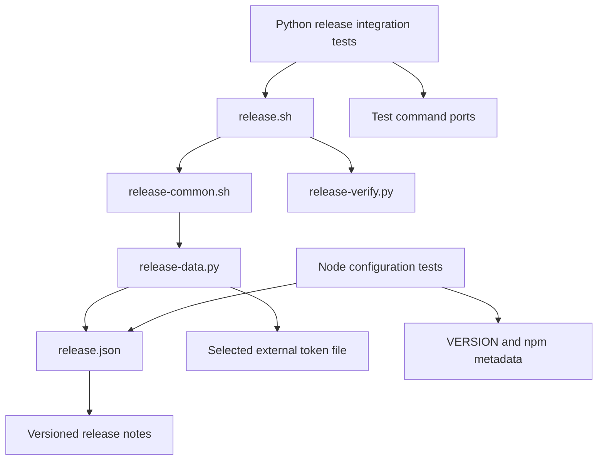

# Brooks-Lint Health Dashboard

- [Brooks-Lint Health Dashboard](#brooks-lint-health-dashboard)
  - [Scope And Scores](#scope-and-scores)
  - [Module Dependency Graph](#module-dependency-graph)
  - [Findings](#findings)
  - [Verification](#verification)
  - [Recommendation](#recommendation)

## Scope And Scores

**Mode:** Health Dashboard

**Scope:** All 10 changed paths on `81-release-token-path` versus `main`, `6387159...9440a95`, plus directly related release authentication and fixture boundaries. This is a branch review, not a whole-project audit. No `.brooks-lint.yaml` exists; balanced defaults apply.

**Composite Score:** 100/100

**Trend:** Stable at 100 compared with the previous Health Dashboard run. Previous scopes differ; this is not evidence of whole-project improvement.

| Dimension | Score | Top Finding |
|-----------|-------|-------------|
| Code Quality | 100/100 | No branch findings |
| Architecture | 100/100 | No branch findings |
| Tech Debt | 100/100 | No branch findings |
| Test Quality | 100/100 | No branch findings |

Scores use weights 0.25, 0.30, 0.25, and 0.20 respectively. No finding deductions apply. Scores describe the reviewed changes, not release readiness or overall test-suite health.

## Module Dependency Graph

Arrows show caller-to-callee or reader-to-input dependencies within the reviewed release path. External publication tools are stubbed only in fixtures.

The default remains owned by `scripts/release.json:7`; `scripts/release-data.py:294-325` retains path selection and credential validation. No new production module, dependency, cycle, upward dependency, or authentication mechanism is introduced.

## Findings

No Critical, Warning, or Suggestion findings in the reviewed branch changes.

- Code quality: configuration changes are limited to the token default and synchronized notes path. Version `0.17.49` agrees across `VERSION`, npm metadata, README, and release documentation. Existing metadata checks guard synchronization; this branch does not introduce a new release-version convention.
- Architecture and debt: R1–R6 scans found no new complexity, policy duplication, dependency inversion, or domain mismatch requiring correction. Keeping the existing authentication helper avoids an unnecessary resolver or migration layer. Independent SSH/Git authentication and dependency versions are unchanged.
- Credential behavior: `auth()` selects `GIT_TOKEN` before configured `token_file`, expands the selected path, and retains external-project, no-symlink, ownership, regular-file, permission, size, and format checks. There is no legacy fallback. Documentation accurately explains operator provisioning and deliberate legacy-path overrides.
- Test quality: the scoped suite map is six existing Node configuration/contract tests, seven new Python integration scenarios, and no new browser/E2E tests. Twelve token/default-focused Python tests were rerun. The new tests retain the literal production tilde path, isolate `HOME`, commit fixture configuration, execute real authentication, and assert no build/publication writes on refusal. Command ports replace external effects rather than mocking authentication. Captured output rejects the synthetic credential sentinel. T1/T2 scans found no actionable obscurity or brittle implementation coupling; event assertions protect the required security ordering.

## Verification

Rerun during review:

- `node --test test/release-config.test.js`: six passed.
- `python3 -B -m unittest discover -s test/release-template -p test_bash_release.py -k token -k new_default -v`: 12 passed, including all seven new scenarios.
- `npm run check`: passed.
- `bash scripts/release.sh --validate`: passed without credentials or remote operations.

Existing implementation-run evidence inspected, not rerun in full:

- `/tmp/opencode/81-release-suite-verified.log`: 161 Python tests, 160 passed, one failure in unchanged `test_ignored_worktree_secret_is_not_in_committed_snapshot`. All seven new scenarios passed. `/tmp/opencode/81-baseline-release.log` reproduces the same `Release requires a clean checkout` failure from unchanged `main`; the fixture appends an ignore entry to `.gitignore` without a separating newline. Neither file is changed by this branch.
- `/tmp/opencode/81-unit.log`: 720 Node tests, 695 passed, 25 failed in unchanged weather-proxy scenarios. Baseline classification is supported by the earlier task verification record; this review did not independently rerun the full baseline Node suite.

These failures limit full-suite confidence but are not introduced by the reviewed diff. Review commands did not access real tokens, publish a release, or contact publication services. No implementation fixes were made.

## Recommendation

The branch is acceptable on the reviewed scope, with no new findings. Provision the new token location or an explicit override before publishing. Track the existing suite failures separately; the recorded baseline failures mean full release verification is not currently green.
