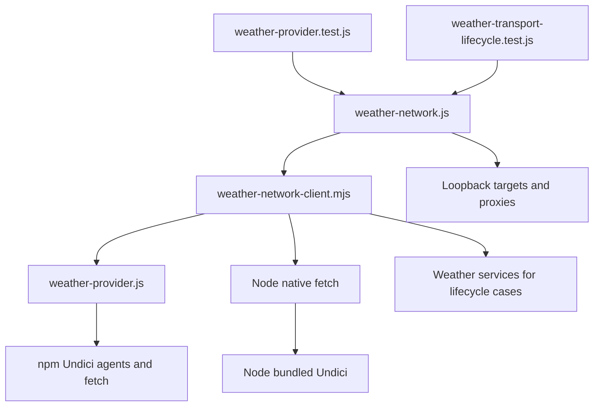

# Brooks-Lint Health Dashboard

- [Brooks-Lint Health Dashboard](#brooks-lint-health-dashboard)
  - [Scope And Scores](#scope-and-scores)
  - [Module Dependency Graph](#module-dependency-graph)
  - [Findings](#findings)
  - [Verification And Limits](#verification-and-limits)
  - [Recommendation](#recommendation)

## Scope And Scores

**Mode:** Health Dashboard

**Scope:** Plan review of `tasks/82-weather-proxy-verification/2-plan.md` at `32ed1e0`, checked against its goal and the directly related transport, network fixtures, tests, runtime settings, and release conventions. This assesses the proposed changes, not whole-project health or a completed fix. No `.brooks-lint.yaml` exists; balanced defaults apply.

**Composite Score:** 100/100

**Trend:** Stable at 100 compared with the previous Health Dashboard run; scopes differ.

| Dimension | Score | Top Finding |
|-----------|-------|-------------|
| Code Quality | 100/100 | No plan findings |
| Architecture | 100/100 | No plan findings |
| Tech Debt | 100/100 | No plan findings |
| Test Quality | 100/100 | No plan findings |

Weights are 0.25, 0.30, 0.25, and 0.20 respectively. The proposed-change review supplies the code-quality dimension. No finding deductions apply.

## Module Dependency Graph

Arrows show the existing caller-to-dependency boundaries the plan preserves; fixture children select native or weather fetch.

This is a scoped runtime graph, not a complete static import graph. No new production layer or dependency is required by the plan.

## Findings

No Critical, Warning, or Suggestion findings in the plan.

- Code quality: diagnosis precedes fixes. Step 1 requires complete error causes and separates HTTPS-proxy failures from native routing differences. Step 2 bounds edits to evidenced defects rather than assuming a dependency upgrade will solve everything.
- Architecture: the transport keeps its existing fetch/stop boundary. Fixture changes remain test-only; connection tuning, disposal ownership, and process defaults are explicit invariants. No planned cycle or inversion is introduced.
- Debt: the R1–R6 scan found no actionable new complexity or policy duplication in the proposed approach. The prohibition on a speculative general proxy parser limits tactical workaround growth. Native behavior is explicitly separated from the application's intentional wildcard contract.
- Test quality: the plan directly addresses native-first failures hiding weather results, requires independent execution, and preserves strict routing and TLS negative checks. Evidence-based native expectations are permitted, but arbitrary acceptance, new skips, weakened errors, and runtime-range narrowing are forbidden. This addresses T1/T2 risks without treating diagnostic instrumentation as a proven cause.
- Suite map: the two focused files define 18 top-level cases after their static loops expand, including six service-lifecycle cases; nested proxy matrices add subtests. These are loopback/network and lifecycle integration checks, not browser E2E coverage. The plan also runs six release-configuration checks and the full application suite. No new unit-test count is promised before the actual defect is known.

## Verification And Limits

- Compared the plan with `1-goal.md`, `src/weather-provider.js:7-44`, proxy/routing tests, child DNS/socket instrumentation, certificate fixtures, and service-lifecycle checks.
- Confirmed the plan covers opt-in/out, lowercase and empty overrides, wildcard apex/subdomains, port matching, environment refresh, TLS rejection, abort, socket cleanup, and caller-owned transport behavior.
- The Node 26 bundled/npm Undici distinction and Node 24 deployment target are supported by the planning-stage environment inspection, `package.json`, and `Dockerfile`. A version difference is not itself a diagnosed defect.
- Runtime reproduction, full nested error traces, and cross-version results remain implementation work. This review did not rerun tests, establish the root cause, or claim that release verification now passes.
- The known unrelated Python ignored-secret fixture failure remains explicitly outside scope. No plan or implementation code was changed during this review.

## Recommendation

Proceed with the plan. Start by reproducing and tracing both fetch paths independently; only then choose fixture, transport, or narrowly evidenced native-expectation corrections. Preserve the stated security checks and record unavailable runtime coverage rather than claiming untested compatibility.
