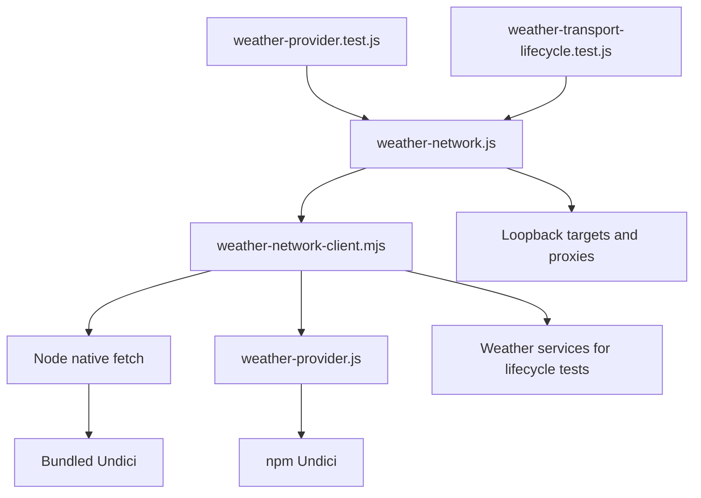

# Brooks-Lint Health Dashboard

- [Brooks-Lint Health Dashboard](#brooks-lint-health-dashboard)
  - [Scope And Scores](#scope-and-scores)
  - [Module Dependency Graph](#module-dependency-graph)
  - [Findings](#findings)
  - [Verification And Limits](#verification-and-limits)
  - [Recommendation](#recommendation)

## Scope And Scores

**Mode:** Health Dashboard

**Scope:** All 12 changed paths on `82-weather-proxy-verification` versus `main`, `7c49564...94dc164`, plus directly related transport and lifecycle fixture context. This is a branch-scoped review, not a whole-project audit. No `.brooks-lint.yaml` exists; balanced defaults apply.

**Composite Score:** 100/100

**Trend:** Stable at 100 compared with the previous Health Dashboard run; scopes differ.

| Dimension | Score | Top Finding |
|-----------|-------|-------------|
| Code Quality | 100/100 | No branch findings |
| Architecture | 100/100 | No branch findings |
| Tech Debt | 100/100 | No branch findings |
| Test Quality | 100/100 | No branch findings |

Weights are 0.25, 0.30, 0.25, and 0.20 respectively. No finding deductions apply. The score does not certify untested runtimes or full release readiness.

## Module Dependency Graph

Arrows describe runtime callers and dependencies in the reviewed test boundary, not every static import.

Production transport boundaries and dependencies are unchanged. The HTTPS fixture's DNS name resolves to loopback through the existing child lookup seam; it does not introduce external DNS or network dependencies.

## Findings

No Critical, Warning, or Suggestion findings in the reviewed branch changes.

- Code quality: the changes address evidenced causes without changing production behavior. The diagnostic stack in `test/fixtures/weather-network-client.mjs:76` exposes the original TLS argument failure. `test/fixtures/weather-network.js:20,71-72` supplies a DNS proxy hostname covered by the generated certificate, rather than weakening verification. Release metadata consistently advances to `0.17.50`; dependency versions and the release token default are unchanged.
- Architecture: no new production module, cycle, upward dependency, or proxy abstraction is introduced. Test-only hostname/certificate changes stay inside the existing fixture boundary. The original socket instrumentation still forwards connection arguments unchanged.
- Debt: R1–R6 scans found no new actionable complexity, duplicated production policy, or domain mismatch. The local native-target substitution is explicit and limited to `.invalid` fixture URLs. It avoids runtime-version tables and does not redefine weather routing based on incidental native behavior.
- Test quality: native and weather cases now run as independent named subtests. Every original weather-apex expectation remains strict; the subdomain case, wrong ports, unrelated host, case/list handling, lowercase overrides, and live environment edits retain routing assertions. Native wildcard comparisons exercise the shared subdomain contract rather than claiming identical apex semantics. TLS coverage is expanded to both implementations with the same restricted expected failure codes; `ERR_INVALID_ARG_VALUE` is not accepted as a certificate failure. T1/T2 scans found no actionable new obscurity or brittleness.
- Suite map: the two focused weather files contain 18 top-level loopback/network and lifecycle tests, with nested matrices totaling 168 reported tests. Six configuration/contract tests bring the review's focused run to 174. There are no new browser E2E tests. The full Node suite reports 820 tests; these totals include parent and nested-test accounting, not 820 independent unit scenarios.

## Verification And Limits

Rerun during review on Node.js `v26.13.0`, bundled Undici `8.12.2`, npm Undici `8.11.2`:

- `node --test test/weather-provider.test.js test/weather-transport-lifecycle.test.js test/release-config.test.js`: 174 passed, zero failed, zero skipped. Log: `/tmp/opencode/82-review-focused.log`.
- `npm test`: 820 passed, zero failed, zero skipped. Log: `/tmp/opencode/82-review-unit.log`.
- `npm run check`: passed.
- `bash scripts/release.sh --validate`: passed without credentials or remote operations.
- `git diff --check`: passed before adding review artifacts.

Inspected the original diagnosis log at `/tmp/opencode/82-weather-cause.log`: both bundled and npm Undici paths supplied `127.0.0.1` as `options.servername`, which Node rejected before certificate validation. The reviewed fix uses a valid hostname and retains actual trust/hostname rejection tests; it does not provide general IP-address HTTPS proxy support. Documentation states that limitation.

Node 24 deployment-runtime validation remains unavailable and is recorded honestly in `4-implemented.md`. No production transport changes make that absence a newly introduced behavior defect, but Node 26 results must not be presented as Node 24 evidence. The previously recorded unrelated ignored-secret Python fixture failure remains unchanged; the Python release suite was not rerun. No actual release was published or real credential accessed. No implementation fixes were made during review.

## Recommendation

The branch is acceptable on the reviewed scope. Run the focused tests on an operator-provided Node 24.5+ runtime when available, and track the unrelated Python fixture failure separately. Application verification is green on the tested Node 26 runtime; this does not claim every publication prerequisite is satisfied.
