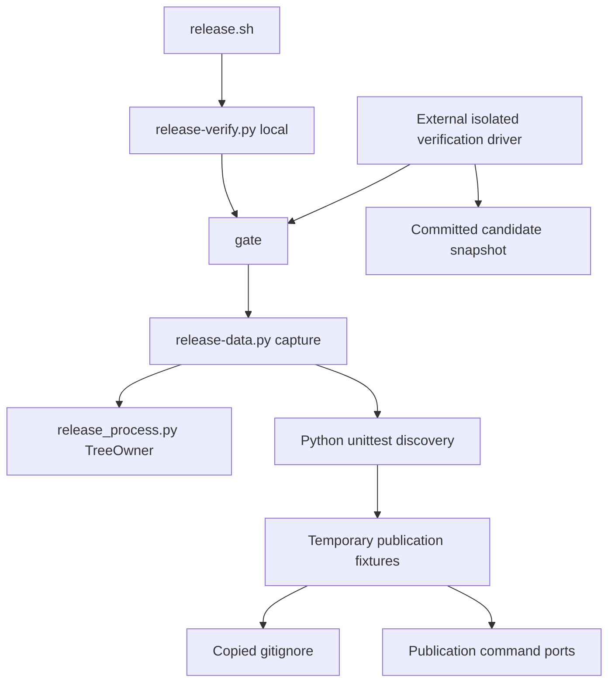

# Brooks-Lint Health Dashboard

- [Brooks-Lint Health Dashboard](#brooks-lint-health-dashboard)
  - [Scope And Scores](#scope-and-scores)
  - [Module Dependency Graph](#module-dependency-graph)
  - [Findings](#findings)
  - [Verification And Limits](#verification-and-limits)
  - [Recommendation](#recommendation)

## Scope And Scores

**Mode:** Health Dashboard

**Scope:** Review of `tasks/83-release-verification-timeout/2-plan.md` at `f93ca41`, checked against its goal, release gate, fixture setup, supervision, tests, and publishing guidance. This assesses the proposed changes, not completed implementation or whole-project health. No `.brooks-lint.yaml` exists; balanced defaults apply.

**Composite Score:** 100/100

**Trend:** Stable at 100 compared with the previous Health Dashboard run; scopes differ.

| Dimension | Score | Top Finding |
|-----------|-------|-------------|
| Code Quality | 100/100 | No plan findings |
| Architecture | 100/100 | No plan findings |
| Tech Debt | 100/100 | No plan findings |
| Test Quality | 100/100 | No plan findings |

Weights are 0.25, 0.30, 0.25, and 0.20 respectively. The proposed changes supply the code-quality dimension. No finding deductions apply; the score does not establish that the release gate now passes.

## Module Dependency Graph

Arrows show runtime calls or fixture inputs relevant to this plan.

The external driver is an implementation-time verification tool, not a new operator bypass. The planned in-suite orchestration test records dispatch without recursively running the complete suite.

## Findings

No Critical, Warning, or Suggestion findings in the plan.

- Code quality: the plan diagnoses runtime and newline handling separately. The proposed 1,800-second timeout is provisional, with a measurable final headroom criterion rather than an unexplained increase. It does not change unrelated gate budgets or hide failed tests.
- Architecture: bounded execution remains in `gate()` and `DATA.capture()`, with process ownership retained by `TreeOwner`. An internal command/budget constant or cohesive helper is allowed only to prevent test-driver drift. No new publication mode, recursive test dependency, or production layering change is proposed.
- Debt: R1–R6 scans found no actionable new complexity or duplicated policy in the proposed approach. Profiling stays outside production. The fixture owns the newline correction; the project's ignore file is not changed merely to accommodate test setup. Process-supervision optimization requires evidence and cannot silently shorten safety grace periods.
- Test quality: the plan preserves real pass/fail/timeout/overflow checks, detached-descendant and interruption tests, unrelated sentinels, and publication blocking. Readiness markers limit timing races. Both newline variants must reach successful stubbed build execution while proving ignore behavior, a clean checkout, and secret exclusion; early refusal cannot masquerade as success.
- Suite map: static inspection found 161 existing test methods across three files: 130 in `test_bash_release.py`, 20 in `test_progress.py`, and 11 in `test_verification.py`. These mix unit checks, real subprocess integration, and stubbed publication integration. Planned additions include at least one orchestration unit test and two newline integration scenarios, plus extensions to real gate checks; exact added method counts remain an implementation choice. No new real-publication E2E test is proposed. Complete gate execution remains an external acceptance run, not a recursively discovered test.

## Verification And Limits

- Compared the plan with `1-goal.md`, `scripts/release-verify.py:33-91`, `scripts/release-data.py:146-225`, `scripts/release_process.py`, ignored-secret fixture setup and stub build-context checks, and existing verification/progress tests.
- Confirmed that the production gate currently supplies 1,200 seconds and routes timeout through the bounded command runner. `capture()` invokes owned-tree cleanup in `finally`; the plan retains that behavior and tests it explicitly.
- Confirmed the ignored-secret test appends without a separator before committing fixture configuration. The plan tests the missing-newline boundary without weakening committed-snapshot assertions.
- Static method counts were collected without importing or executing the test suites. This review did not reproduce runtime measurements, select the final timeout, or run the planned complete gate. Historical duration is evidence for investigation, not a substitute for candidate measurements.
- The committed-candidate snapshot requirement and follow-up results commit avoid verifying stale base code. No implementation code or plan text was modified during review.

## Recommendation

Proceed with the plan. Measure before choosing the final timeout, keep the full-suite gate outside recursive discovery, and report the committed candidate revision with its measured margin. Treat the newline fix and process-cleanup protections as independent acceptance checks, not consequences assumed from a longer timeout.
