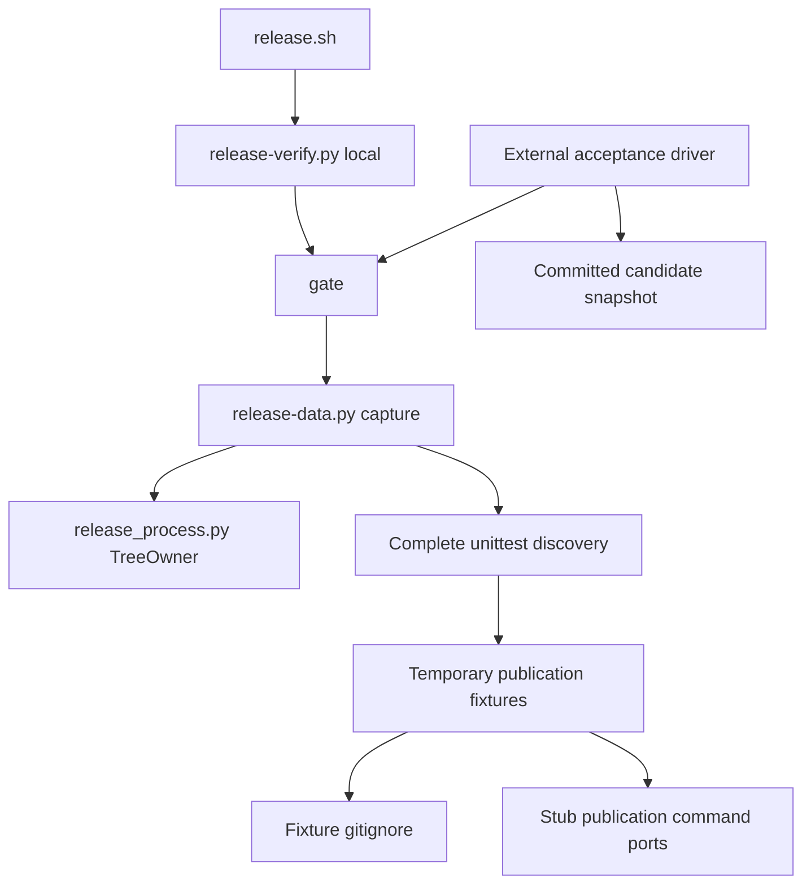

# Brooks-Lint Health Dashboard

- [Brooks-Lint Health Dashboard](#brooks-lint-health-dashboard)
  - [Scope And Scores](#scope-and-scores)
  - [Module Dependency Graph](#module-dependency-graph)
  - [Findings](#findings)
  - [Verification And Limits](#verification-and-limits)
  - [Recommendation](#recommendation)

## Scope And Scores

**Mode:** Health Dashboard

**Scope:** All 11 changed paths on `83-release-verification-timeout` versus `main`, `3c347fb...35fe41c`, plus directly related gate, snapshot, supervision, and publication-fixture boundaries. This is a branch review, not a whole-project audit. No `.brooks-lint.yaml` exists; balanced defaults apply.

**Composite Score:** 100/100

**Trend:** Stable at 100 compared with the previous Health Dashboard run; scopes differ.

| Dimension | Score | Top Finding |
|-----------|-------|-------------|
| Code Quality | 100/100 | No branch findings |
| Architecture | 100/100 | No branch findings |
| Tech Debt | 100/100 | No branch findings |
| Test Quality | 100/100 | No branch findings |

Weights are 0.25, 0.30, 0.25, and 0.20 respectively. No finding deductions apply. The score does not certify every publication prerequisite or runtime environment.

## Module Dependency Graph

Arrows show runtime callers and inputs in the reviewed verification path.

The external driver is a temporary validation tool, not a new production entry point. The in-suite orchestration test observes dispatch without recursively executing unittest discovery.

## Findings

No Critical, Warning, or Suggestion findings in the reviewed changes.

- Code quality: `scripts/release-verify.py:31-32,91` retains the full unittest command and gives only the release suite a fixed 1,800-second budget. Recorded complete runs support the increase. Application and other gate budgets, failure propagation, output limits, and cleanup code are unchanged. Version `0.17.51` is synchronized across metadata, release configuration, README, and notes.
- Architecture: the change preserves existing gate/capture/ownership boundaries. It adds only internal command/budget constants, not a dependency, bypass flag, cache, new publication mode, or cycle. The newline repair stays in fixture setup rather than modifying production ignore rules or snapshot filtering.
- Debt: R1–R6 scans found no actionable new complexity, duplicated production policy, or unrelated coupling. The small helper shares the two newline scenarios without a general fixture framework. Keeping explicit expected command/budget assertions in a contract test is intentional protection, not an independent production configuration source.
- Test quality: both newline scenarios prove the preceding pattern remains intact, the secret is ignored/untracked, and the checkout is clean before release simulation. Build and release-post events prove successful execution; the existing stub builder rejects a context containing `ignored-secret`, and captured output rejects its sentinel. The orchestration test checks once-only complete discovery, budget, source directory, isolated HOME, and gate order. Its mocked gate is a dispatch observer; separate real gate tests and the external complete acceptance run verify execution. Timeout coverage checks descendant startup, reaping, and unrelated-process survival. T1/T2 scans found no actionable new obscurity or brittleness.
- Suite map: the release suite grows from 161 to 164 test methods: 131 Bash/data tests, 20 progress tests, and 13 verification tests. These mix unit and real-subprocess/stubbed-publication integration coverage. The three added methods are one orchestration unit test, one newline publication-fixture integration case, and one real timeout-cleanup integration test. No real-publication E2E test is added.

## Verification And Limits

Rerun during review on Python `3.12.3` and Node.js `v26.13.0`:

- Focused real gate, dispatch, descendant-reaping, and interruption tests: five passed in 2.708 seconds. Log: `/tmp/opencode/83-review-gates.log`.
- Both ignored-secret scenarios and nonrecursive publication-blocking test: three passed in 40.585 seconds. Log: `/tmp/opencode/83-review-fixtures.log`.
- `npm test`: 820 passed, zero failed/skipped. Log: `/tmp/opencode/83-review-unit.log`.
- `npm run check`, six release-configuration tests, `bash scripts/release.sh --validate`, and `git diff --check`: passed.

Inspected implementation-run evidence instead of repeating both complete long runs:

- Clean baseline `3c347fb`: 161 tests, one ignored-secret failure, 1,214.042 seconds; independently exceeds the old budget. Evidence: `/tmp/opencode/83-baseline-timings.json`.
- Clean candidate `a4dccc9`: 164 passed in 1,263.869 seconds, leaving 536.131 seconds under the new deadline, or 42.42% above measured runtime. Evidence: `/tmp/opencode/83-candidate-timings.json`.
- Actual candidate release-test gate: 164 passed, exit 0, in 1,251.737 seconds. Inspected `/tmp/opencode/83-isolated-gate.py`, `/tmp/opencode/83-isolated-gate.log`, and `/tmp/opencode/83-gate-result.json`: the driver exports the candidate with `DATA.snapshot()`, loads its verifier, uses its exact command/budget in an isolated environment, and confirms refusal for nonzero/timeout simulations. It verifies an empty temporary fixture parent, owned-descendant cleanup, unrelated sentinel survival, and removal of its snapshot work directory.
- `git diff a4dccc9..HEAD --name-only` confirms only publishing documentation and the implementation record changed after the complete candidate runs. No executable code changed after that evidence was collected.

Measured headroom exceeds the plan's 25% requirement but is not a guarantee for slower hosts. The branch makes no speedup claim and does not shorten cleanup grace periods. This review did not invoke real publication, read real credentials, or modify implementation code. Full production packaging and platform-image publication prerequisites are not certified by this scoped review.

## Recommendation

The branch is acceptable on the reviewed scope. Retain the finite deadline and failure diagnostics; investigate any future timeout rather than bypassing verification. Both reported causes are addressed with independent regression coverage and complete committed-candidate gate evidence.
